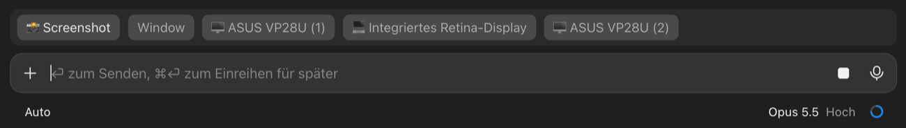

# screenshot – a Claude Code mod

Take a screenshot with one click above Claude's prompt and drop it straight into your message,
without a detour through Finder or the clipboard.



- **📸 Screenshot** – drag a region (space switches to window mode, Esc cancels)
- **Window** – click a window; it is captured on its own, with its shadow
- **One button per display** (e.g. 🖥 Studio Display, 💻 Built-in Retina Display) – captures that whole display

The PNG is saved under `~/.claude/screenshots/`, its path is written into the prompt, and the image
is also put on the clipboard (Cmd+V in the prompt attaches it as a real image). When you send a
prompt that contains a screenshot path, Claude gets a hidden hint to open the image with its
Read tool, so it actually looks at it.

The same actions work as a slash command:

```
/screenshot                 drag a region
/screenshot window          click a window
/screenshot screen [n]      whole display n (as in screencapture -D, 1 = main display)
```

macOS only (uses `screencapture` and `osascript`). Works in the terminal and in the Claude
desktop app.

## Install

In a Claude Code session (terminal or desktop app):

```
/plugin install screenshot --marketplace drndwarp/claude-screenshot-mod
```

Answer `y` to add the marketplace, pick a scope (e.g. "user" for all projects), then run
`/reload-plugins` or restart Claude.

## Screen recording permission

Without it the mod reports "Screen recording not allowed". Open System Settings → Privacy &
Security → **Screen & System Audio Recording** and allow:

- **Terminal:** the terminal app `claude` runs in.
- **Claude desktop app:** not only "Claude" but also the bundled Claude Code program `claude.app`
  (`com.anthropic.claude-code`). It lives under
  `~/Library/Application Support/Claude/claude-code/<version>/…/claude.app`; add it with "+" and
  Cmd+Shift+G, then restart the app.

## Privacy

Screenshots stay on your Mac under `~/.claude/screenshots/`, but whatever you put in a prompt is
sent to Claude. Check what is on the image before you send it, especially terminal windows.

## Development

```
claude plugin validate .
claude plugin test .
```

## License

MIT, see [LICENSE](LICENSE).
